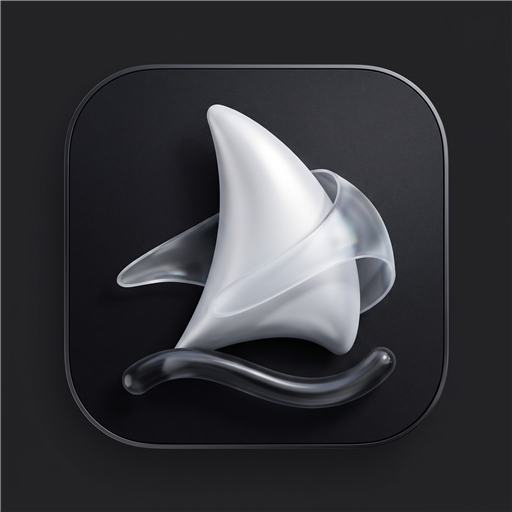

<p align="center">
  
</p>

<h1 align="center">Vela</h1>

<p align="center">
  Un browser Chromium minimale per Windows, con più spazio per navigare.
</p>

<p align="center">
  <a href="README.md"><kbd>English</kbd></a>
  &nbsp;
  <a href="README.it.md"><kbd>Italiano</kbd></a>
</p>

<p align="center">
  <a href="https://github.com/fur6i/vela/releases">Download</a>
  ·
  <a href="https://github.com/fur6i/vela/issues">Segnala un problema</a>
  ·
  <a href="SECURITY.md">Sicurezza</a>
</p>

---

Vela porta su Windows un’interfaccia Chromium essenziale, con superfici ispirate al vetro. Barra degli indirizzi centrata, sidebar discreta e strumenti compatti lasciano spazio alle pagine.

La direzione visiva prende ispirazione da Safari, mentre la navigazione tra gli spazi riprende alcune idee di Arc. Vela è un progetto indipendente, sviluppato con Electron e Chromium.

## Funzionalità

- **Interfaccia minimale:** sfumature leggere, sfondo personalizzabile e aspetto chiaro/scuro.
- **Sidebar a comparsa:** avvicina il cursore al bordo sinistro oppure mantienila fissata.
- **Spazi personalizzabili:** separa le schede tra Personale e Lavoro, modificando nomi, colori, emoji e immagini.
- **Gestione flessibile delle schede:** schede fissate, riordino tramite trascinamento, duplicazione, silenziamento, riapertura e panoramica visiva.
- **Navigazione rapida:** launcher per nuove schede con suggerimenti di ricerca e accesso alle schede recenti.
- **Motore di ricerca a scelta:** Google, Bing, Brave Search o Ecosia, selezionabili durante la configurazione.
- **Preferiti modificabili:** organizza i collegamenti con le icone dei siti.
- **Italiano e inglese:** cambia subito la lingua dalle impostazioni. Anche l’installer Windows offre entrambe le lingue.
- **Download compatti:** gestisci i trasferimenti da un popup laterale senza coprire tutta la pagina.

## Strumenti integrati

Gli strumenti si trovano in un dock riordinabile e aprono pannelli compatti accanto alla navigazione.

| Strumento | Funzione |
| --- | --- |
| Media Downloader | Scarica contenuti HTTPS pubblici supportati in MP4, MKV, MP3 o M4A. |
| Ad Blocker | Filtra le pubblicità con controlli globali e per singolo sito. |
| Privacy | Filtra tracker e cookie di terze parti, invia segnali GPC/DNT e rifiuta i banner cookie riconosciuti. |
| Volume | Regola il volume delle singole schede da 0% a 600%, dove la sorgente multimediale consente l’amplificazione. |
| Immagini | Salva le immagini supportate in PNG, JPEG o WebP. |
| Pagina intera | Esporta il contenuto caricato della pagina in PNG, JPEG o PDF. |
| VirusTotal | Cerca report tramite l’impronta dei file scaricati o selezionati; permette l’invio dopo conferma. |
| Panic Button | Apre un sito scelto nella scheda attiva tramite una combinazione di tasti personalizzabile. |

**Media Downloader:** usalo soltanto per contenuti tuoi, autorizzati dal titolare o di pubblico dominio. Rispetta la normativa applicabile e i termini del servizio. Non aggira DRM o autenticazione. I componenti esterni vengono scaricati su richiesta con verifica SHA-256 e mantengono le licenze upstream.

**VirusTotal:** i report nel pannello richiedono una tua chiave API. Il caricamento può condividere il contenuto del file con VirusTotal e i suoi partner. Non inviare file riservati. Un report senza rilevazioni non garantisce la sicurezza del file.

## Estensioni

Installa estensioni tramite URL o ID del Chrome Web Store, oppure carica una cartella già estratta.

I pacchetti dello Store vengono sottoposti a verifica della firma e dell’identità, estrazione con limiti di sicurezza e conferma dei permessi prima del caricamento. La compatibilità dipende dalle API disponibili in Electron: alcune estensioni possono installarsi senza funzionare completamente.

Le estensioni aggiunte non vengono caricate nelle finestre private. Non è fornita una compatibilità completa con le estensioni Chrome o Manifest V2/V3.

## Prestazioni

Vela cerca di ridurre il lavoro superfluo in background:

- Le schede dei siti ripristinate vengono caricate quando le selezioni.
- Sidebar e dock vengono inizializzati su richiesta.
- Le pagine in background mantengono il throttling standard di Chromium.
- La sospensione manuale può liberare i processi delle pagine inattive.
- Le cache di anteprime e favicon hanno limiti di dimensione.
- Cache dei filtri, aggiornamenti UI raggruppati e polling adattivo della sidebar riducono le operazioni ripetute.

Il consumo di risorse dipende da siti, contenuti multimediali, estensioni e hardware. Non sono state stabilite classifiche comparative con altri browser. [PERFORMANCE.md](PERFORMANCE.md) descrive il metodo di misurazione e distingue i risultati storici.

## Download e aggiornamenti

Richiede **Windows 10 o 11, x64**.

Le build pubblicate sono disponibili nelle [release GitHub](https://github.com/fur6i/vela/releases):

- **Installer:** consigliato per l’uso abituale; supporta gli aggiornamenti dalle release GitHub pubblicate.
- **Eseguibile portatile:** funziona senza installazione e si aggiorna manualmente. Il profilo di navigazione resta comunque salvato localmente.

Le versioni installate possono scaricare gli aggiornamenti in background e proporre il pulsante Riavvia quando sono pronti.

Gli eseguibili attualmente **non sono firmati digitalmente**, quindi Windows SmartScreen può mostrare un avviso. Verifica la provenienza del download. Il repository include un workflow pubblico di release tramite GitHub Actions.

## Compilazione dai sorgenti

Per lo sviluppo servono Node.js e npm. Il workflow di release usa Node.js 24.

```powershell
git clone https://github.com/fur6i/vela.git
cd vela
npm ci
npm start
```

Verifica e creazione dei pacchetti Windows:

```powershell
npm run check
npm run smoke
node scripts/audit-release.cjs
npm run release
```

I pacchetti vengono generati in `release/`. Gli smoke test aprono finestre di prova con audio disattivato.

Per le misurazioni locali delle prestazioni:

```powershell
npm run benchmark
```

## Scorciatoie

| Combinazione | Azione |
| --- | --- |
| Ctrl+T | Apre il launcher nuova scheda |
| Ctrl+L | Seleziona la barra degli indirizzi |
| Ctrl+W | Chiude la scheda corrente |
| Ctrl+Shift+T | Riapre una scheda chiusa |
| Ctrl+Tab / Ctrl+Shift+Tab | Cambia scheda |
| Ctrl+Shift+N | Apre una finestra privata |
| Ctrl+D | Aggiunge o rimuove un preferito |
| Ctrl+F | Cerca nella pagina |
| Ctrl+R | Ricarica |
| Ctrl+P | Stampa |

## Sicurezza e privacy

Vela usa sandbox, isolamento del contesto, IPC limitato, una CSP rigorosa per l’applicazione e impostazioni di packaging rafforzate. Le pagine web non ricevono accesso a Node.js.

Le finestre private utilizzano profili temporanei separati e sessioni di navigazione in memoria. La navigazione privata non fornisce anonimato e i file scaricati rimangono sul disco. Panic Button non cancella la cronologia e non chiude le altre schede.

Vela è un progetto nelle prime fasi di sviluppo. Non include un gestore di password, sincronizzazione cloud o un servizio equivalente a Safe Browsing. La compatibilità con siti, estensioni e servizi DRM può variare.

Consulta [SECURITY.md](SECURITY.md) per implementazione, limiti e segnalazioni di vulnerabilità.

## Licenza e attribuzioni

Il codice originale di Vela è distribuito sotto [licenza MIT](LICENSE).

Electron, Chromium, Ghostery Adblocker, electron-updater e gli altri componenti mantengono le proprie licenze. Anche le sottoscrizioni dei filtri e gli strumenti multimediali scaricati conservano i termini upstream. Consulta [THIRD_PARTY_NOTICES.txt](THIRD_PARTY_NOTICES.txt) e [assets/licenses](assets/licenses).

Il logo Vela è stato generato con Gemini.

I font vengono forniti dal sistema operativo; non vengono distribuiti font proprietari Apple.

Safari, Arc, Chrome, Chrome Web Store, Windows e gli altri nomi di prodotto appartengono ai rispettivi titolari. I riferimenti descrivono soltanto ispirazione o interoperabilità. Vela non è affiliata, approvata o sponsorizzata dai rispettivi titolari.

## Contribuire

Segnalazioni di problemi e pull request mirate sono benvenute. Indica versione di Vela, versione di Windows e passaggi chiari per riprodurre il problema.

Per le segnalazioni di sicurezza segui [SECURITY.md](SECURITY.md). Non allegare chiavi API, cookie o profili personali di navigazione alle issue pubbliche.
