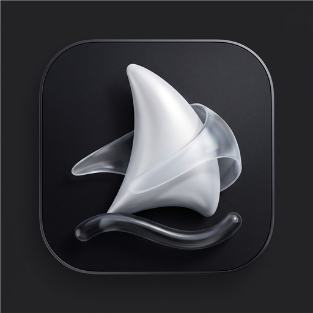

<p align="center">
  
</p>

<h1 align="center">Vela</h1>

<p align="center">
  A quiet, minimal Chromium browser for Windows.
</p>

<p align="center">
  <a href="README.md"><kbd>English</kbd></a>
  &nbsp;
  <a href="README.it.md"><kbd>Italiano</kbd></a>
</p>

<p align="center">
  <a href="https://github.com/fur6i/vela/releases">Downloads</a>
  ·
  <a href="https://github.com/fur6i/vela/issues">Report a bug</a>
  ·
  <a href="SECURITY.md">Security</a>
</p>

---

Vela brings a restrained, glass-inspired interface to Chromium browsing on Windows. A centered address bar, an unobtrusive sidebar and compact tools keep your pages in focus.

Its visual direction draws inspiration from Safari, while its workspace navigation takes cues from Arc. Vela is an independent project built with Electron and Chromium.

## Features

- **Minimal glass interface:** subtle gradients, customizable background colors and light/dark appearance.
- **Sidebar on demand:** reveal it from the left edge or keep it pinned.
- **Customizable spaces:** separate your tabs into Personal and Work, with editable names, colors, emoji and images.
- **Flexible tab management:** pinned tabs, drag-to-reorder, duplication, muting, reopening and a visual tab overview.
- **Quick navigation:** a new-tab launcher with search suggestions and shortcuts to recently used tabs.
- **Your search engine:** choose Google, Bing, Brave Search or Ecosia during setup.
- **Editable favorites:** organize shortcuts with website icons.
- **Italian and English:** switch the interface language instantly in Settings. The Windows installer also offers both languages.
- **Compact downloads:** manage transfers in a side popup without covering the whole page.

## Built-in tools

Tools live in a reorderable dock and open compact panels alongside your browsing.

| Tool | What it does |
| --- | --- |
| Media Downloader | Download supported public HTTPS media as MP4, MKV, MP3 or M4A. |
| Ad Blocker | Built-in ad filtering with global and per-site controls. |
| Privacy | Tracker filtering, third-party cookie controls, GPC/DNT signals and rejection of recognized cookie banners. |
| Volume | Adjust individual tabs from 0% to 600%, where the media source supports amplification. |
| Images | Save supported images as PNG, JPEG or WebP. |
| Full Page Capture | Export loaded page content as PNG, JPEG or PDF. |
| VirusTotal | Look up downloaded or selected files by hash; optionally submit files after confirmation. |
| Panic Button | Open a chosen website in the active tab using a configurable keyboard shortcut. |

**Media Downloader:** use it only for content you own, have permission to download, or that is in the public domain. Respect applicable law and service terms. It does not bypass DRM or authentication. Helper binaries are downloaded on demand with SHA-256 verification and retain their upstream licenses.

**VirusTotal:** in-app reports require your own API key. Uploading a file may share its contents with VirusTotal and its partners. Do not submit confidential files. A clean report does not guarantee safety.

## Extensions

Install extensions from a Chrome Web Store URL or ID, or load an unpacked extension folder.

Store packages undergo signature and identity verification, bounded extraction and a permission confirmation before loading. Compatibility depends on the extension APIs supported by Electron: some extensions may install but not work fully.

Added extensions are not loaded in private windows. Full Chrome extension or Manifest V2/V3 compatibility is not provided.

## Performance

Vela aims to reduce unnecessary background work:

- Restored website tabs load when selected.
- Sidebar and dock surfaces are initialized on demand.
- Background pages retain Chromium’s standard throttling.
- Manual tab suspension can release inactive page processes.
- Preview and favicon caches are bounded.
- Filter caching, batched UI updates and adaptive sidebar polling reduce repeated work.

Resource use depends on websites, media, extensions and hardware. Comparative performance rankings have not been established. See [PERFORMANCE.md](PERFORMANCE.md) for the measurement method and clearly labeled historical results.

## Download and updates

Requires **Windows 10 or 11, x64**.

Published builds are available from [GitHub Releases](https://github.com/fur6i/vela/releases):

- **Installer:** recommended for regular use; supports updates from published GitHub releases.
- **Portable executable:** runs without installation and is updated manually. Its browsing profile is still stored locally.

Installed builds can download updates in the background and offer a Restart action when an update is ready.

The executables are currently **unsigned**, so Windows SmartScreen may display a warning. Verify the download source. The repository includes a public GitHub Actions release workflow.

## Build from source

Development requires Node.js and npm. The release workflow uses Node.js 24.

```powershell
git clone https://github.com/fur6i/vela.git
cd vela
npm ci
npm start
```

Validation and Windows packaging:

```powershell
npm run check
npm run smoke
node scripts/audit-release.cjs
npm run release
```

Build outputs are written to `release/`. Smoke tests open test windows with audio muted.

For local performance measurements:

```powershell
npm run benchmark
```

## Keyboard shortcuts

| Shortcut | Action |
| --- | --- |
| Ctrl+T | Open the new-tab launcher |
| Ctrl+L | Focus the address bar |
| Ctrl+W | Close the current tab |
| Ctrl+Shift+T | Reopen a closed tab |
| Ctrl+Tab / Ctrl+Shift+Tab | Switch tabs |
| Ctrl+Shift+N | Open a private window |
| Ctrl+D | Toggle a favorite |
| Ctrl+F | Find in page |
| Ctrl+R | Reload |
| Ctrl+P | Print |

## Security and privacy

Vela uses sandboxing, context isolation, restricted IPC, a strict application CSP and hardened packaging settings. Website pages do not receive Node.js access.

Private windows use separate temporary profiles and in-memory browsing sessions. Private browsing does not provide anonymity, and files you download remain on disk. Panic Button does not erase history or close other tabs.

Vela is an early-stage browser project. It does not include a password manager, cloud synchronization or a Safe Browsing-equivalent service. Website, extension and DRM compatibility can vary.

Read [SECURITY.md](SECURITY.md) for implementation details, limitations and vulnerability reporting.

## License and acknowledgments

Vela’s original code is released under the [MIT License](LICENSE).

Electron, Chromium, Ghostery Adblocker, electron-updater and other components retain their own licenses. Filter subscriptions and downloaded media tools also retain their upstream terms. See [THIRD_PARTY_NOTICES.txt](THIRD_PARTY_NOTICES.txt) and [assets/licenses](assets/licenses).

The Vela logo was generated using Gemini.

Fonts are supplied by the operating system; proprietary Apple fonts are not bundled.

Safari, Arc, Chrome, Chrome Web Store, Windows and other product names belong to their respective owners. References describe inspiration or interoperability only. Vela is not affiliated with, endorsed by or sponsored by those owners.

## Contributing

Bug reports and focused pull requests are welcome. Include your Vela version, Windows version and clear reproduction steps.

Follow [SECURITY.md](SECURITY.md) for security reports. Never attach API keys, cookies or personal browsing profiles to public issues.
